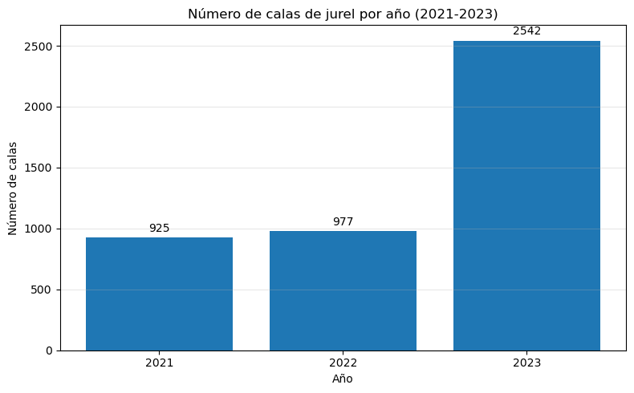
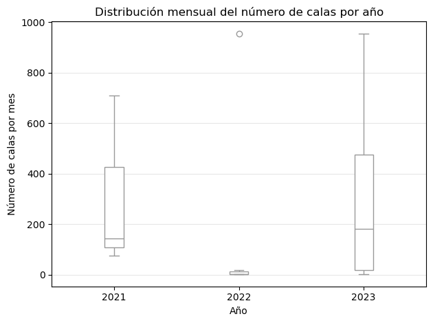
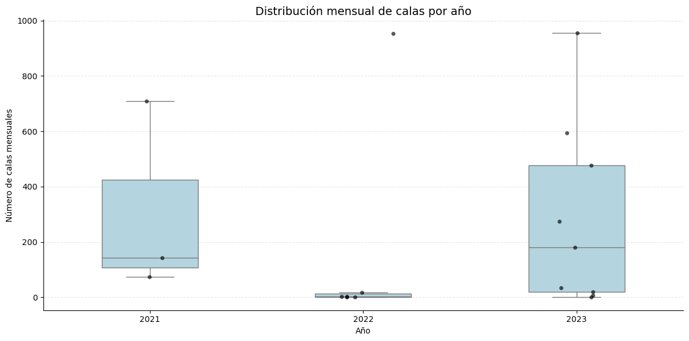
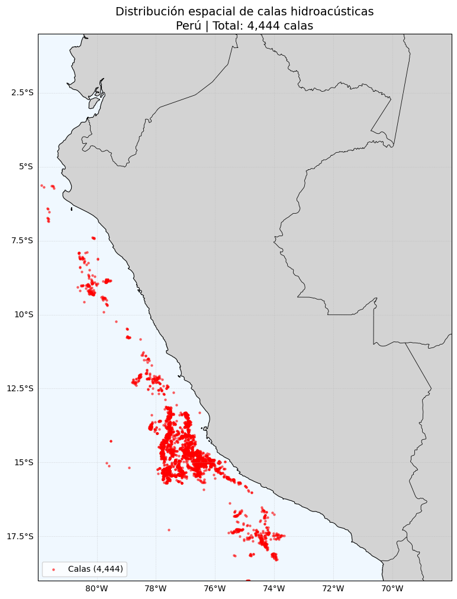
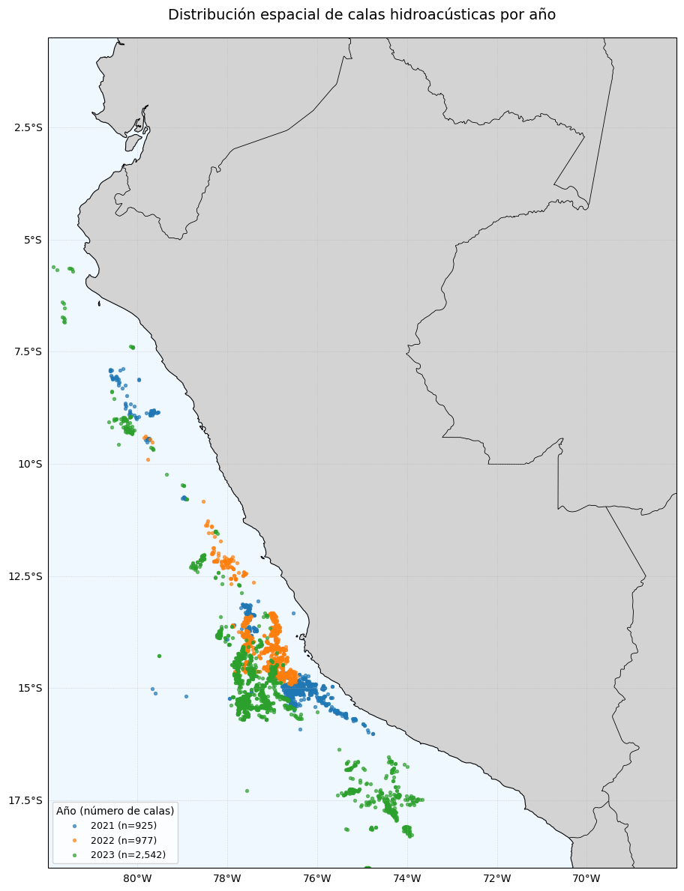
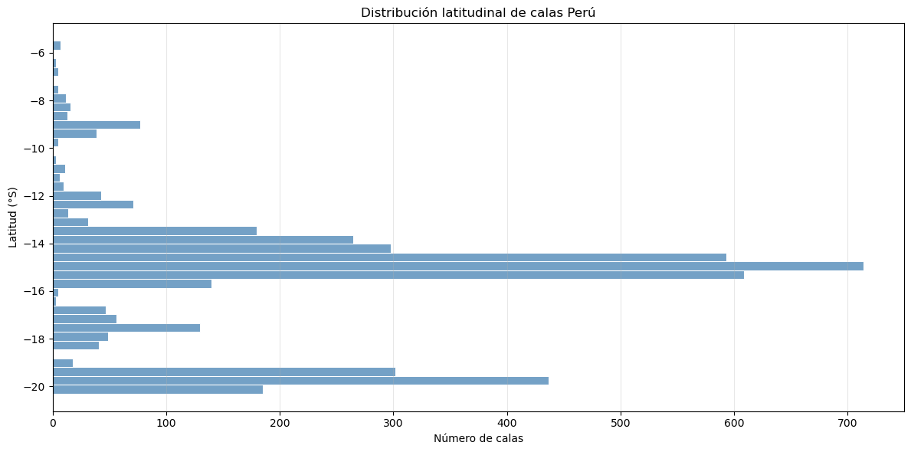
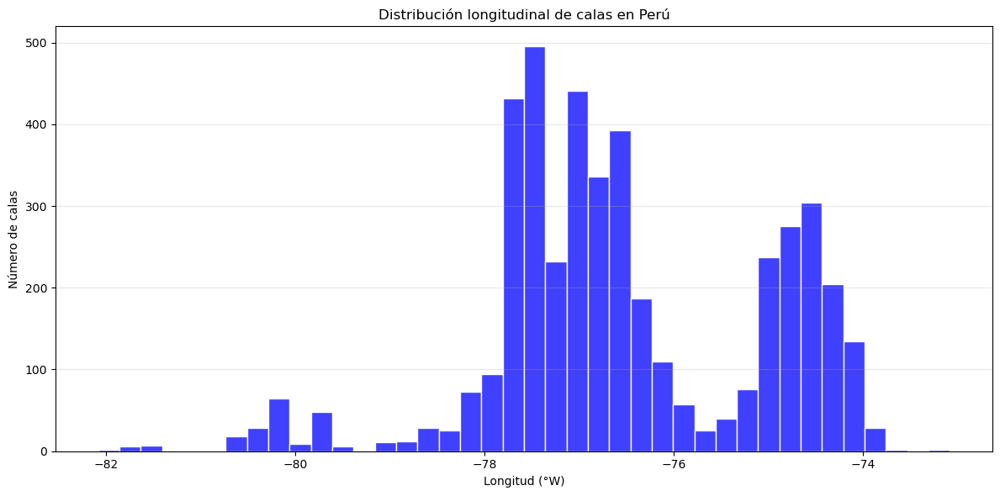
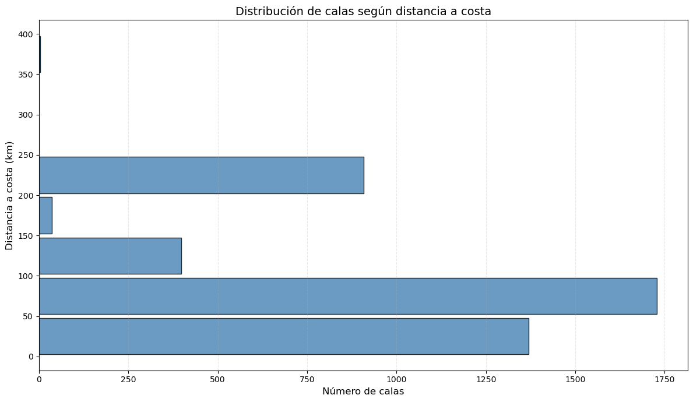

# Trabajo Hackaton 2026 - data de jurel (Trachurus murphyi)- 

## Base de datos de registros de captura de jurel (Trachurus murphyi) de la flota industrial peruana.

###  Fuente: Instituto Humboldt Marino y Acuícola (IHMA).


```python
import os
```


```python
os.getcwd()
```


    '/home/jovyan/tutoriales/aliaga-hackaton-2026/codigo'


# 1. Cargar los datos


```python
import pandas as pd
```


```python
archivo = "/home/jovyan/tutoriales/aliaga-hackaton-2026/datos/CALAS 2023 CHD.csv"
calas = pd.read_csv(archivo, encoding="latin1")
calas.head()
```


<div>
<style scoped>
    .dataframe tbody tr th:only-of-type {
        vertical-align: middle;
    }

    .dataframe tbody tr th {
        vertical-align: top;
    }

    .dataframe thead th {
        text-align: right;
    }
</style>
<table border="1" class="dataframe">
  <thead>
    <tr style="text-align: right;">
      <th></th>
      <th>año</th>
      <th>dc</th>
      <th>categoria_declarado</th>
      <th>id</th>
      <th>empresa</th>
      <th>nave</th>
      <th>fecha_cala</th>
      <th>hora_cala</th>
      <th>zona_pesca</th>
      <th>longitud_decimal</th>
      <th>...</th>
      <th>depredadores superiores</th>
      <th>observacion</th>
      <th>SST</th>
      <th>SSS</th>
      <th>CLOROFILA</th>
      <th>SLA</th>
      <th>ATSM</th>
      <th>ALT</th>
      <th>DC</th>
      <th>watermass</th>
    </tr>
  </thead>
  <tbody>
    <tr>
      <th>0</th>
      <td>2023</td>
      <td>96.362771</td>
      <td>111.147657</td>
      <td>50-150</td>
      <td>PESQUERA CENTINELA</td>
      <td>POLAR I</td>
      <td>17/01/2023</td>
      <td>07:00:00</td>
      <td>NaN</td>
      <td>-77.76</td>
      <td>...</td>
      <td>NaN</td>
      <td>NaN</td>
      <td>22.271782</td>
      <td>35.147568</td>
      <td>0.128391</td>
      <td>10.548333</td>
      <td>0.520833</td>
      <td>9.987505</td>
      <td>108.829022</td>
      <td>SSW</td>
    </tr>
    <tr>
      <th>1</th>
      <td>2023</td>
      <td>91.769197</td>
      <td>104.232940</td>
      <td>50-150</td>
      <td>PESQUERA DIAMANTE</td>
      <td>STEFANO</td>
      <td>5/02/2023</td>
      <td>01:35:00</td>
      <td>NaN</td>
      <td>-78.13</td>
      <td>...</td>
      <td>NaN</td>
      <td>NaN</td>
      <td>22.619804</td>
      <td>35.137202</td>
      <td>0.477112</td>
      <td>10.366667</td>
      <td>0.170000</td>
      <td>6.440445</td>
      <td>101.991171</td>
      <td>SSW</td>
    </tr>
    <tr>
      <th>2</th>
      <td>2023</td>
      <td>94.732100</td>
      <td>105.821618</td>
      <td>50-150</td>
      <td>PESQUERA DIAMANTE</td>
      <td>SEBASTIAN</td>
      <td>5/02/2023</td>
      <td>04:00:00</td>
      <td>NaN</td>
      <td>-78.15</td>
      <td>...</td>
      <td>NaN</td>
      <td>NaN</td>
      <td>22.569075</td>
      <td>35.138687</td>
      <td>0.488596</td>
      <td>10.407500</td>
      <td>0.176667</td>
      <td>6.617016</td>
      <td>102.612731</td>
      <td>SSW</td>
    </tr>
    <tr>
      <th>3</th>
      <td>2023</td>
      <td>73.962886</td>
      <td>105.821618</td>
      <td>50-150</td>
      <td>PESQUERA DIAMANTE</td>
      <td>SEBASTIAN</td>
      <td>5/02/2023</td>
      <td>04:00:00</td>
      <td>NaN</td>
      <td>-78.15</td>
      <td>...</td>
      <td>NaN</td>
      <td>NaN</td>
      <td>22.569075</td>
      <td>35.138687</td>
      <td>0.488596</td>
      <td>10.407500</td>
      <td>0.176667</td>
      <td>6.617016</td>
      <td>102.612731</td>
      <td>SSW</td>
    </tr>
    <tr>
      <th>4</th>
      <td>2023</td>
      <td>76.451202</td>
      <td>105.473460</td>
      <td>50-150</td>
      <td>PESQUERA DIAMANTE</td>
      <td>POLAR IV</td>
      <td>5/02/2023</td>
      <td>05:55:00</td>
      <td>NaN</td>
      <td>-78.15</td>
      <td>...</td>
      <td>NaN</td>
      <td>NaN</td>
      <td>22.572349</td>
      <td>35.145152</td>
      <td>0.620675</td>
      <td>10.494167</td>
      <td>0.190000</td>
      <td>7.007155</td>
      <td>102.170613</td>
      <td>SSW</td>
    </tr>
  </tbody>
</table>
<p>5 rows × 81 columns</p>
</div>


```python
calas.shape
```


    (2542, 81)


```python
import os

[f for f in os.listdir() if f.endswith(".ipynb")]
```


    ['analisis_calas_2021.ipynb']


### Se crea una base de datos total / para todos los años


```python
import pandas as pd
from pathlib import Path
```


```python
# Definir la carpeta donde están los archivos
carpeta_datos = Path("../datos")
```


```python
# Identificar los tres archivos csv
archivos = [
    "CALAS 2021 CHD.csv",
    "CALAS 2022 CHD.csv",
    "CALAS 2023 CHD.csv"
]
```


```python
# Leer los archivos
lista_calas = []

for nombre in archivos:
    ruta = carpeta_datos / nombre
    # Leer CSV
    try:
        df = pd.read_csv(ruta, encoding="utf-8-sig")
    except UnicodeDecodeError:
        df = pd.read_csv(ruta, encoding="latin-1")

    lista_calas.append(df)
    print(f"{nombre}: {df.shape[0]:,} registros")
```

    CALAS 2021 CHD.csv: 925 registros
    CALAS 2022 CHD.csv: 977 registros
    CALAS 2023 CHD.csv: 2,542 registros


```python
# Unir las tres bases de datos
calas_total = pd.concat(
    lista_calas,
    ignore_index=True,
    sort=False
)
```


```python
# Mostrar resultados
print("\nCONSOLIDACIÓN TERMINADA")
print("------------------------")
print(f"Total de registros: {len(calas_total):,}")
print(f"Total de columnas: {len(calas_total.columns)}")
print(f"Archivo guardado en: {archivo_salida}")
```

    
    CONSOLIDACIÓN TERMINADA
    ------------------------
    Total de registros: 4,444
    Total de columnas: 81
    Archivo guardado en: ../datos/CALAS TOTAL CHD.csv


```python
# Visualizar los primeros registros
display(calas_total.head())
```


<div>
<style scoped>
    .dataframe tbody tr th:only-of-type {
        vertical-align: middle;
    }

    .dataframe tbody tr th {
        vertical-align: top;
    }

    .dataframe thead th {
        text-align: right;
    }
</style>
<table border="1" class="dataframe">
  <thead>
    <tr style="text-align: right;">
      <th></th>
      <th>año</th>
      <th>dc</th>
      <th>categoria_declarado</th>
      <th>id</th>
      <th>empresa</th>
      <th>nave</th>
      <th>fecha_cala</th>
      <th>hora_cala</th>
      <th>zona_pesca</th>
      <th>longitud_decimal</th>
      <th>...</th>
      <th>depredadores superiores</th>
      <th>observacion</th>
      <th>SST</th>
      <th>SSS</th>
      <th>CLOROFILA</th>
      <th>SLA</th>
      <th>ATSM</th>
      <th>ALT</th>
      <th>DC</th>
      <th>watermass</th>
    </tr>
  </thead>
  <tbody>
    <tr>
      <th>0</th>
      <td>2021</td>
      <td>7.644040</td>
      <td>50-150</td>
      <td>1</td>
      <td>PESQUERA HAYDUK S.A.</td>
      <td>CHAVELI II</td>
      <td>7/02/2021</td>
      <td>NaN</td>
      <td>NaN</td>
      <td>-75.666667</td>
      <td>...</td>
      <td>NaN</td>
      <td>NaN</td>
      <td>NaN</td>
      <td>NaN</td>
      <td>NaN</td>
      <td>NaN</td>
      <td>NaN</td>
      <td>NaN</td>
      <td>NaN</td>
      <td>NaN</td>
    </tr>
    <tr>
      <th>1</th>
      <td>2021</td>
      <td>12.667118</td>
      <td>50-150</td>
      <td>2</td>
      <td>DIAMANTE</td>
      <td>STEFANO</td>
      <td>16/02/2021</td>
      <td>NaN</td>
      <td>NaN</td>
      <td>-75.866670</td>
      <td>...</td>
      <td>NaN</td>
      <td>NaN</td>
      <td>NaN</td>
      <td>NaN</td>
      <td>NaN</td>
      <td>NaN</td>
      <td>NaN</td>
      <td>NaN</td>
      <td>NaN</td>
      <td>NaN</td>
    </tr>
    <tr>
      <th>2</th>
      <td>2021</td>
      <td>14.126737</td>
      <td>50-150</td>
      <td>3</td>
      <td>PESQUERA EXALMAR S.A.A.</td>
      <td>CARMENCITA</td>
      <td>16/02/2021</td>
      <td>NaN</td>
      <td>NaN</td>
      <td>-75.833333</td>
      <td>...</td>
      <td>NaN</td>
      <td>NaN</td>
      <td>NaN</td>
      <td>NaN</td>
      <td>NaN</td>
      <td>NaN</td>
      <td>NaN</td>
      <td>NaN</td>
      <td>NaN</td>
      <td>NaN</td>
    </tr>
    <tr>
      <th>3</th>
      <td>2021</td>
      <td>14.355709</td>
      <td>50-150</td>
      <td>4</td>
      <td>DIAMANTE</td>
      <td>STEFANO</td>
      <td>16/02/2021</td>
      <td>NaN</td>
      <td>NaN</td>
      <td>-75.866670</td>
      <td>...</td>
      <td>NaN</td>
      <td>NaN</td>
      <td>NaN</td>
      <td>NaN</td>
      <td>NaN</td>
      <td>NaN</td>
      <td>NaN</td>
      <td>NaN</td>
      <td>NaN</td>
      <td>NaN</td>
    </tr>
    <tr>
      <th>4</th>
      <td>2021</td>
      <td>14.898401</td>
      <td>50-150</td>
      <td>5</td>
      <td>PESQUERA HAYDUK S.A.</td>
      <td>CHAVELI II</td>
      <td>16/02/2021</td>
      <td>NaN</td>
      <td>NaN</td>
      <td>-75.883333</td>
      <td>...</td>
      <td>NaN</td>
      <td>NaN</td>
      <td>NaN</td>
      <td>NaN</td>
      <td>NaN</td>
      <td>NaN</td>
      <td>NaN</td>
      <td>NaN</td>
      <td>NaN</td>
      <td>NaN</td>
    </tr>
  </tbody>
</table>
<p>5 rows × 81 columns</p>
</div>


```python
### filtrar data
```


```python
# Variables que se conservarán
columnas_finales = [
    "año",
    "dc",
    "id",
    "fecha_cala",
    "longitud_decimal",
    "latitud_decimal",
    "numero_cala",
    "captura_total"
]

# Crear base depurada
calas_total = calas_total[columnas_finales].copy()
```


```python
# Visualizar los primeros registros
display(calas_total.head())
```


<div>
<style scoped>
    .dataframe tbody tr th:only-of-type {
        vertical-align: middle;
    }

    .dataframe tbody tr th {
        vertical-align: top;
    }

    .dataframe thead th {
        text-align: right;
    }
</style>
<table border="1" class="dataframe">
  <thead>
    <tr style="text-align: right;">
      <th></th>
      <th>año</th>
      <th>dc</th>
      <th>id</th>
      <th>fecha_cala</th>
      <th>longitud_decimal</th>
      <th>latitud_decimal</th>
      <th>numero_cala</th>
      <th>captura_total</th>
    </tr>
  </thead>
  <tbody>
    <tr>
      <th>0</th>
      <td>2021</td>
      <td>7.644040</td>
      <td>1</td>
      <td>7/02/2021</td>
      <td>-75.666667</td>
      <td>-14.966667</td>
      <td>4.0</td>
      <td>70.0</td>
    </tr>
    <tr>
      <th>1</th>
      <td>2021</td>
      <td>12.667118</td>
      <td>2</td>
      <td>16/02/2021</td>
      <td>-75.866670</td>
      <td>-14.950000</td>
      <td>1.0</td>
      <td>115.0</td>
    </tr>
    <tr>
      <th>2</th>
      <td>2021</td>
      <td>14.126737</td>
      <td>3</td>
      <td>16/02/2021</td>
      <td>-75.833333</td>
      <td>-15.000000</td>
      <td>2.0</td>
      <td>67.0</td>
    </tr>
    <tr>
      <th>3</th>
      <td>2021</td>
      <td>14.355709</td>
      <td>4</td>
      <td>16/02/2021</td>
      <td>-75.866670</td>
      <td>-14.983330</td>
      <td>3.0</td>
      <td>80.0</td>
    </tr>
    <tr>
      <th>4</th>
      <td>2021</td>
      <td>14.898401</td>
      <td>5</td>
      <td>16/02/2021</td>
      <td>-75.883333</td>
      <td>-14.983333</td>
      <td>1.0</td>
      <td>100.0</td>
    </tr>
  </tbody>
</table>
</div>


```python
# Guardar el archivo consolidado
archivo_salida = carpeta_datos / "CALAS TOTAL CHD.csv"

calas_total.to_csv(
    archivo_salida,
    index=False,
    encoding="utf-8-sig"
)
```


```python
# Contar registros por año
resumen_anual = calas_total.groupby("año").size().reset_index(name="Total de calas")

# Mostrar resumen
display(resumen_anual)
```


<div>
<style scoped>
    .dataframe tbody tr th:only-of-type {
        vertical-align: middle;
    }

    .dataframe tbody tr th {
        vertical-align: top;
    }

    .dataframe thead th {
        text-align: right;
    }
</style>
<table border="1" class="dataframe">
  <thead>
    <tr style="text-align: right;">
      <th></th>
      <th>año</th>
      <th>Total de calas</th>
    </tr>
  </thead>
  <tbody>
    <tr>
      <th>0</th>
      <td>2021</td>
      <td>925</td>
    </tr>
    <tr>
      <th>1</th>
      <td>2022</td>
      <td>977</td>
    </tr>
    <tr>
      <th>2</th>
      <td>2023</td>
      <td>2542</td>
    </tr>
  </tbody>
</table>
</div>


# Analisis Exploratorio de datos


```python
calas_total.dtypes
```


    año                   int64
    dc                  float64
    id                   object
    fecha_cala              str
    longitud_decimal    float64
    latitud_decimal     float64
    numero_cala         float64
    captura_total       float64
    dtype: object


```python
calas_total.info()
```

    <class 'pandas.DataFrame'>
    RangeIndex: 4444 entries, 0 to 4443
    Data columns (total 8 columns):
     #   Column            Non-Null Count  Dtype  
    ---  ------            --------------  -----  
     0   año               4444 non-null   int64  
     1   dc                4444 non-null   float64
     2   id                4444 non-null   object 
     3   fecha_cala        4444 non-null   str    
     4   longitud_decimal  4444 non-null   float64
     5   latitud_decimal   4444 non-null   float64
     6   numero_cala       4258 non-null   float64
     7   captura_total     4444 non-null   float64
    dtypes: float64(5), int64(1), object(1), str(1)
    memory usage: 320.0+ KB


```python
resumen_tipos = pd.DataFrame({
    "Variable": calas_total.columns,
    "Tipo de dato": calas_total.dtypes.astype(str).values,
    "Datos no nulos": calas_total.notna().sum().values,
    "Datos nulos": calas_total.isna().sum().values
})

display(resumen_tipos)
```


<div>
<style scoped>
    .dataframe tbody tr th:only-of-type {
        vertical-align: middle;
    }

    .dataframe tbody tr th {
        vertical-align: top;
    }

    .dataframe thead th {
        text-align: right;
    }
</style>
<table border="1" class="dataframe">
  <thead>
    <tr style="text-align: right;">
      <th></th>
      <th>Variable</th>
      <th>Tipo de dato</th>
      <th>Datos no nulos</th>
      <th>Datos nulos</th>
    </tr>
  </thead>
  <tbody>
    <tr>
      <th>0</th>
      <td>año</td>
      <td>int64</td>
      <td>4444</td>
      <td>0</td>
    </tr>
    <tr>
      <th>1</th>
      <td>dc</td>
      <td>float64</td>
      <td>4444</td>
      <td>0</td>
    </tr>
    <tr>
      <th>2</th>
      <td>id</td>
      <td>object</td>
      <td>4444</td>
      <td>0</td>
    </tr>
    <tr>
      <th>3</th>
      <td>fecha_cala</td>
      <td>str</td>
      <td>4444</td>
      <td>0</td>
    </tr>
    <tr>
      <th>4</th>
      <td>longitud_decimal</td>
      <td>float64</td>
      <td>4444</td>
      <td>0</td>
    </tr>
    <tr>
      <th>5</th>
      <td>latitud_decimal</td>
      <td>float64</td>
      <td>4444</td>
      <td>0</td>
    </tr>
    <tr>
      <th>6</th>
      <td>numero_cala</td>
      <td>float64</td>
      <td>4258</td>
      <td>186</td>
    </tr>
    <tr>
      <th>7</th>
      <td>captura_total</td>
      <td>float64</td>
      <td>4444</td>
      <td>0</td>
    </tr>
  </tbody>
</table>
</div>


```python
import matplotlib.pyplot as plt

# Filtrar periodo de estudio
datos = resumen_anual[
    resumen_anual["año"].between(2021, 2023)
]

plt.figure(figsize=(8, 5))

barras = plt.bar(
    datos["año"].astype(str),
    datos["Total de calas"]
)

# Mostrar valores sobre las barras
plt.bar_label(barras, fmt="%.0f", padding=3)

plt.xlabel("Año")
plt.ylabel("Número de calas")
plt.title("Número de calas de jurel por año (2021-2023)")

plt.grid(axis="y", alpha=0.3)
plt.tight_layout()
plt.show()
```


    

    


# Box plot por meses y años 


```python
## box plot por años
import pandas as pd
import matplotlib.pyplot as plt
import seaborn as sns

# Convertir fecha_cala a formato datetime
calas_total["fecha_cala"] = pd.to_datetime(
    calas_total["fecha_cala"],
    errors="coerce",
    dayfirst=True
)
```


```python
# Extraer año y mes de la fecha
calas_total["anio"] = calas_total["fecha_cala"].dt.year
calas_total["mes"] = calas_total["fecha_cala"].dt.month

# Contar número de calas por mes y año
calas_mensuales = (
    calas_total
    .groupby(["anio", "mes"])
    .size()
    .reset_index(name="numero_calas")
)
```


```python
# Boxplot superpuesto
sns.boxplot(
    data=calas_mensuales,
    x="anio",
    y="numero_calas",
    width=0.15,
    showfliers=True,
    color="white"
)

plt.title("Distribución mensual del número de calas por año")
plt.xlabel("Año")
plt.ylabel("Número de calas por mes")
plt.grid(axis="y", alpha=0.3)

plt.tight_layout()
plt.show()

```


    

    


```python

import matplotlib.pyplot as plt
import seaborn as sns

plt.figure(figsize=(12, 6))

# Boxplot
sns.boxplot(
    data=calas_mensuales,
    x="anio",
    y="numero_calas",
    color="lightblue",
    width=0.45,
    showfliers=False
)

# Puntos individuales de cada mes
sns.stripplot(
    data=calas_mensuales,
    x="anio",
    y="numero_calas",
    color="black",
    size=5,
    alpha=0.65,
    jitter=0.15
)

plt.title("Distribución mensual de calas por año", fontsize=14)
plt.xlabel("Año")
plt.ylabel("Número de calas mensuales")

plt.grid(axis="y", linestyle="--", alpha=0.3)
sns.despine()

plt.tight_layout()
plt.show()

```


    

    


## Mapa de distribución de calas total


```python

# Instalar si es necesario:
# %pip install cartopy

import matplotlib.pyplot as plt
import cartopy.crs as ccrs
import cartopy.feature as cfeature
import pandas as pd

# -----------------------------------------
# 1. Preparar coordenadas
# -----------------------------------------
df = calas_total.copy()

df["longitud_decimal"] = pd.to_numeric(
    df["longitud_decimal"], errors="coerce"
)

df["latitud_decimal"] = pd.to_numeric(
    df["latitud_decimal"], errors="coerce"
)

# Eliminar filas sin coordenadas
df = df.dropna(subset=["longitud_decimal", "latitud_decimal"])

# Número total de calas con coordenadas válidas
total_calas = len(df)

# -----------------------------------------
# 2. Crear mapa
# -----------------------------------------
fig = plt.figure(figsize=(10, 12))

ax = plt.axes(projection=ccrs.PlateCarree())

# Extensión geográfica del Perú
ax.set_extent([-82, -68, -19, -0.5])

# Tierra, océano y costa
ax.add_feature(cfeature.LAND, facecolor="lightgray")
ax.add_feature(cfeature.OCEAN, facecolor="aliceblue")
ax.add_feature(cfeature.COASTLINE, linewidth=0.8)
ax.add_feature(cfeature.BORDERS, linewidth=0.6)

# -----------------------------------------
# 3. Representar puntos de calas
# -----------------------------------------
ax.scatter(
    df["longitud_decimal"],
    df["latitud_decimal"],
    s=5,
    color="red",
    alpha=0.5,
    transform=ccrs.PlateCarree(),
    label=f"Calas ({total_calas:,})"
)

# -----------------------------------------
# 4. Grilla geográfica
# -----------------------------------------
gl = ax.gridlines(
    draw_labels=True,
    linewidth=0.4,
    linestyle="--",
    alpha=0.5
)

gl.top_labels = False
gl.right_labels = False

# -----------------------------------------
# 5. Título y leyenda
# -----------------------------------------
plt.title(
    f"Distribución espacial de calas\n"
    f"Perú | Total: {total_calas:,} calas",
    fontsize=14
)

plt.legend(loc="lower left")
plt.show()

```


    

    


## Zonas de pesca por años


```python
import matplotlib.pyplot as plt
import cartopy.crs as ccrs
import cartopy.feature as cfeature
import pandas as pd

# -----------------------------------------
# 1. Preparar datos
# -----------------------------------------
df = calas_total.copy()

df["longitud_decimal"] = pd.to_numeric(
    df["longitud_decimal"], errors="coerce"
)

df["latitud_decimal"] = pd.to_numeric(
    df["latitud_decimal"], errors="coerce"
)

df["año"] = pd.to_numeric(df["año"], errors="coerce")

df = df.dropna(
    subset=["longitud_decimal", "latitud_decimal", "año"]
)

# Años disponibles
anios = sorted(df["año"].unique())

# -----------------------------------------
# 2. Crear mapa
# -----------------------------------------
fig = plt.figure(figsize=(11, 12))

ax = plt.axes(projection=ccrs.PlateCarree())

ax.set_extent([-82, -68, -19, -0.5])

# Elementos geográficos
ax.add_feature(cfeature.LAND, facecolor="lightgray")
ax.add_feature(cfeature.OCEAN, facecolor="aliceblue")
ax.add_feature(cfeature.COASTLINE, linewidth=0.8)
ax.add_feature(cfeature.BORDERS, linewidth=0.6)

# -----------------------------------------
# 3. Graficar calas por año
# -----------------------------------------
colores = plt.cm.tab10(
    range(len(anios))
)

for anio, color in zip(anios, colores):

    datos_anio = df[df["año"] == anio]

    ax.scatter(
        datos_anio["longitud_decimal"],
        datos_anio["latitud_decimal"],
        s=8,
        color=color,
        alpha=0.65,
        transform=ccrs.PlateCarree(),
        label=f"{int(anio)} (n={len(datos_anio):,})"
    )

# -----------------------------------------
# 4. Grilla geográfica
# -----------------------------------------
gl = ax.gridlines(
    draw_labels=True,
    linewidth=0.4,
    linestyle="--",
    alpha=0.5
)

gl.top_labels = False
gl.right_labels = False

# -----------------------------------------
# 5. Título y leyenda
# -----------------------------------------
ax.set_title(
    "Distribución espacial de calas hidroacústicas por año",
    fontsize=14,
    pad=18
)

ax.legend(
    title="Año (número de calas)",
    loc="lower left",
    fontsize=9
)

plt.tight_layout()
plt.show()

```


    

    


## Histograma de calas por latitud


```python
## Histograma de calas por latitud
import matplotlib.pyplot as plt
import seaborn as sns

# Eliminar coordenadas faltantes
df = calas_total.dropna(subset=["latitud_decimal"]).copy()

plt.figure(figsize=(12, 6))

sns.histplot(
    data=df,
    y="latitud_decimal",
    bins=40,
    color="steelblue",
    edgecolor="white"
)

plt.title("Distribución latitudinal de calas Perú")
plt.xlabel("Número de calas")
plt.ylabel("Latitud (°S)")

plt.grid(axis="x", alpha=0.3)
plt.tight_layout()
plt.show()

```


    

    


## histograma de calas por longitud 


```python
### histograma por calas

plt.figure(figsize=(12, 6))

sns.histplot(
    data=calas_total,
    x="longitud_decimal",
    bins=40,
    color="blue",
    edgecolor="white"
)

plt.title("Distribución longitudinal de calas en Perú")
plt.xlabel("Longitud (°W)")
plt.ylabel("Número de calas")

plt.grid(axis="y", alpha=0.3)
plt.tight_layout()
plt.show()

```


    

    


## Distribucion de calas segun distancia de costa (mn)


```python
import pandas as pd
import matplotlib.pyplot as plt
import seaborn as sns

# -----------------------------------
# Preparar datos
# -----------------------------------
df = calas_total.copy()

df["dc"] = pd.to_numeric(df["dc"], errors="coerce")

df = df.dropna(subset=["dc"])

# -----------------------------------
# Definir intervalos de distancia
# -----------------------------------
intervalos = range(
    0,
    int(df["dc"].max()) + 50,
    50
)

df["intervalo_dc"] = pd.cut(
    df["dc"],
    bins=intervalos,
    right=False
)

# Contar calas por intervalo
frecuencia = (
    df.groupby("intervalo_dc", observed=False)
    .size()
    .reset_index(name="numero_calas")
)

# Punto medio de cada intervalo
frecuencia["dc_medio"] = frecuencia["intervalo_dc"].apply(
    lambda x: x.mid
)

# -----------------------------------
# Gráfico
# -----------------------------------
plt.figure(figsize=(12, 7))

plt.barh(
    frecuencia["dc_medio"],
    frecuencia["numero_calas"],
    height=45,
    color="steelblue",
    edgecolor="black",
    alpha=0.8
)

plt.xlabel("Número de calas", fontsize=12)
plt.ylabel("Distancia a costa (km)", fontsize=12)

plt.title(
    "Distribución de calas según distancia a costa",
    fontsize=14
)

plt.grid(axis="x", linestyle="--", alpha=0.3)

plt.tight_layout()
plt.show()

```


    

    


# Funciones


```python
# funciones del promedio mensual de calas
def promedio_mensual(datos):
    resultado = (
        datos.groupby(["anio", "mes"])["numero_calas"]
        .mean()
        .reset_index(name="promedio_calas")
    )
    return resultado
```


```python
promedio_calas = promedio_mensual(calas_mensuales)
display(promedio_calas)
```


<div>
<style scoped>
    .dataframe tbody tr th:only-of-type {
        vertical-align: middle;
    }

    .dataframe tbody tr th {
        vertical-align: top;
    }

    .dataframe thead th {
        text-align: right;
    }
</style>
<table border="1" class="dataframe">
  <thead>
    <tr style="text-align: right;">
      <th></th>
      <th>anio</th>
      <th>mes</th>
      <th>promedio_calas</th>
    </tr>
  </thead>
  <tbody>
    <tr>
      <th>0</th>
      <td>2021</td>
      <td>1</td>
      <td>74.0</td>
    </tr>
    <tr>
      <th>1</th>
      <td>2021</td>
      <td>2</td>
      <td>709.0</td>
    </tr>
    <tr>
      <th>2</th>
      <td>2021</td>
      <td>3</td>
      <td>142.0</td>
    </tr>
    <tr>
      <th>3</th>
      <td>2022</td>
      <td>1</td>
      <td>954.0</td>
    </tr>
    <tr>
      <th>4</th>
      <td>2022</td>
      <td>2</td>
      <td>17.0</td>
    </tr>
    <tr>
      <th>5</th>
      <td>2022</td>
      <td>3</td>
      <td>1.0</td>
    </tr>
    <tr>
      <th>6</th>
      <td>2022</td>
      <td>4</td>
      <td>2.0</td>
    </tr>
    <tr>
      <th>7</th>
      <td>2022</td>
      <td>9</td>
      <td>1.0</td>
    </tr>
    <tr>
      <th>8</th>
      <td>2022</td>
      <td>10</td>
      <td>2.0</td>
    </tr>
    <tr>
      <th>9</th>
      <td>2023</td>
      <td>1</td>
      <td>1.0</td>
    </tr>
    <tr>
      <th>10</th>
      <td>2023</td>
      <td>2</td>
      <td>955.0</td>
    </tr>
    <tr>
      <th>11</th>
      <td>2023</td>
      <td>3</td>
      <td>275.0</td>
    </tr>
    <tr>
      <th>12</th>
      <td>2023</td>
      <td>4</td>
      <td>19.0</td>
    </tr>
    <tr>
      <th>13</th>
      <td>2023</td>
      <td>5</td>
      <td>7.0</td>
    </tr>
    <tr>
      <th>14</th>
      <td>2023</td>
      <td>6</td>
      <td>476.0</td>
    </tr>
    <tr>
      <th>15</th>
      <td>2023</td>
      <td>7</td>
      <td>595.0</td>
    </tr>
    <tr>
      <th>16</th>
      <td>2023</td>
      <td>9</td>
      <td>180.0</td>
    </tr>
    <tr>
      <th>17</th>
      <td>2023</td>
      <td>12</td>
      <td>34.0</td>
    </tr>
  </tbody>
</table>
</div>


```python
# funcion para calcular la varianza
def varianza_mensual(datos):
    resultado = (
        datos.groupby(["anio"])["numero_calas"]
        .var()
        .reset_index(name="varianza_calas")
    )
    return resultado
```


```python
varianza_calas = varianza_mensual(calas_mensuales)
display(varianza_calas)
```


<div>
<style scoped>
    .dataframe tbody tr th:only-of-type {
        vertical-align: middle;
    }

    .dataframe tbody tr th {
        vertical-align: top;
    }

    .dataframe thead th {
        text-align: right;
    }
</style>
<table border="1" class="dataframe">
  <thead>
    <tr style="text-align: right;">
      <th></th>
      <th>anio</th>
      <th>varianza_calas</th>
    </tr>
  </thead>
  <tbody>
    <tr>
      <th>0</th>
      <td>2021</td>
      <td>121556.333333</td>
    </tr>
    <tr>
      <th>1</th>
      <td>2022</td>
      <td>150265.366667</td>
    </tr>
    <tr>
      <th>2</th>
      <td>2023</td>
      <td>110530.527778</td>
    </tr>
  </tbody>
</table>
</div>


```python
# funcion conjunta media y varianza
estadisticas_mensuales = (
    calas_mensuales.groupby("anio")["numero_calas"]
    .agg(
        promedio="mean",
        varianza="var",
        desviacion_estandar="std",
        minimo="min",
        maximo="max"
    )
    .reset_index()
)

display(estadisticas_mensuales)
```


<div>
<style scoped>
    .dataframe tbody tr th:only-of-type {
        vertical-align: middle;
    }

    .dataframe tbody tr th {
        vertical-align: top;
    }

    .dataframe thead th {
        text-align: right;
    }
</style>
<table border="1" class="dataframe">
  <thead>
    <tr style="text-align: right;">
      <th></th>
      <th>anio</th>
      <th>promedio</th>
      <th>varianza</th>
      <th>desviacion_estandar</th>
      <th>minimo</th>
      <th>maximo</th>
    </tr>
  </thead>
  <tbody>
    <tr>
      <th>0</th>
      <td>2021</td>
      <td>308.333333</td>
      <td>121556.333333</td>
      <td>348.649298</td>
      <td>74</td>
      <td>709</td>
    </tr>
    <tr>
      <th>1</th>
      <td>2022</td>
      <td>162.833333</td>
      <td>150265.366667</td>
      <td>387.640770</td>
      <td>1</td>
      <td>954</td>
    </tr>
    <tr>
      <th>2</th>
      <td>2023</td>
      <td>282.444444</td>
      <td>110530.527778</td>
      <td>332.461318</td>
      <td>1</td>
      <td>955</td>
    </tr>
  </tbody>
</table>
</div>


```python

```
